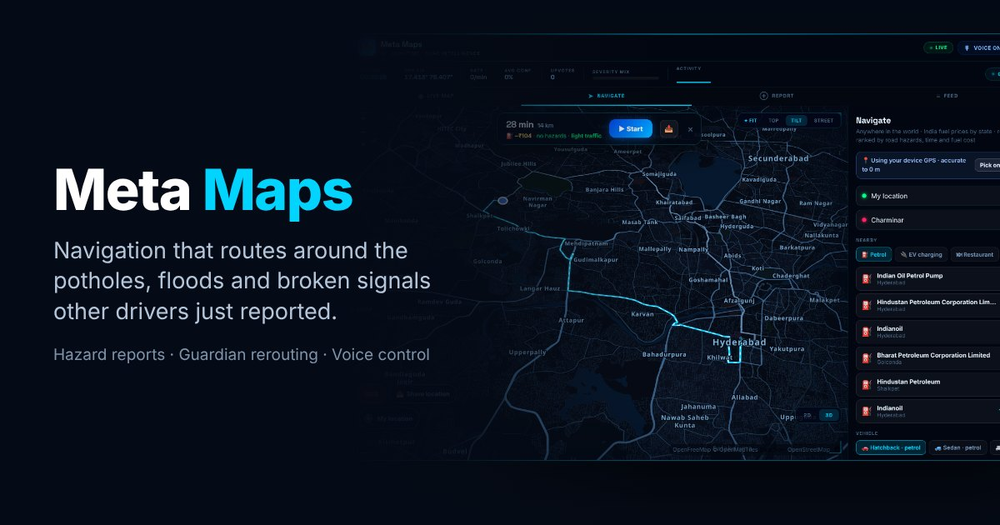
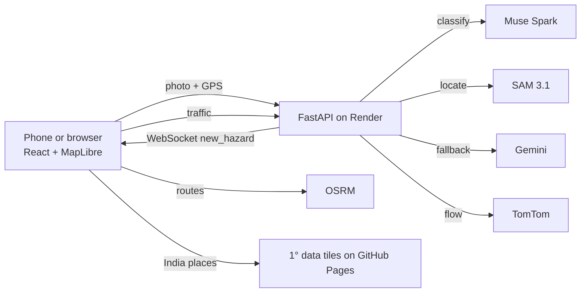

# Meta Maps

Navigation that knows about the road, not just the route. Drivers report potholes, flooding, accidents and broken signals with one photo or one sentence. A vision model checks the photo, the hazard appears on every nearby driver's map within seconds, routes are ranked around it, and a Guardian agent reroutes you mid-drive when a serious hazard appears ahead.

**Live app:** https://vedhrishi.github.io/meta-maps/
**Built for:** Meta Global AI Developer Hackathon (Oct 26 – Nov 4, 2026), Indie Developer track, "Build for Your World".

Meta Maps is an independent hackathon project. It is not made by, affiliated with or endorsed by Meta Platforms, Inc.



## Why

Indian roads change faster than any map. A pothole that appeared after last night's rain, a flooded underpass or a dead traffic signal is not in Google Maps or Apple Maps, but the driver who just passed it knows. Meta Maps turns that knowledge into a shared, AI-verified layer that every route takes into account.

## What it does

- **One-photo hazard reports.** The photo is classified (is it a road hazard, what kind, how severe, what should drivers do) and **Meta SAM 3.1** marks where the hazard is in the photo. A second report within 60 m counts as a confirmation instead of a duplicate pin.
- **Guardian agent.** During a trip it watches the road ahead for new critical or high-severity reports, asks the router for alternatives, compares them, and switches only when the detour is clearly better. It says why, out loud. Tap "Try a drive" to watch it handle a staged blockage (the staged hazard is local to your screen and labelled as simulated).
- **Hazard-aware routing.** Routes ranked by time, reported hazards and fuel cost, with turn-by-turn voice, speed limits and per-vehicle fuel estimates using state fuel prices.
- **Traffic.** Live TomTom flow sampled along the route, blended with a typical-traffic model by city, day and hour. When a route is ready it tells you how long the drive will take and whether traffic is unusual.
- **Voice control.** "Hey Meta, navigate to Charminar", "how's the traffic", "any hazards ahead", "nearest petrol pump", "reroute", "report pothole" and more. Press `?` in the app for the full list.
- **Rain on your route.** When a route is ready it checks the forecast for when you will be halfway and when you arrive, shows it on the route card and says it out loud if rain is likely ("will it rain" works any time).
- **Share and SOS.** Share your location, your arrival time or a place as a link that opens straight into directions (WhatsApp, SMS or anything on the phone's share sheet). The SOS button calls 112, 108 or the 1033 highway helpline in one tap and sends your exact location to someone you trust. "Share my location", "share my ETA" and "emergency" work by voice.
- **Nearest anything.** Petrol, EV charging, restaurants, ATMs, hospitals, pharmacies, police, parking and more, from data stored on the device, with a live OpenStreetMap search as backup.
- **India-wide search.** About 4.9 million place and building names across India, split into 1° tiles that the browser downloads on demand and caches, so small-town searches work on weak connections.

## Meta models used

| Model | Where | What it does |
|---|---|---|
| **Muse Spark** (`muse-spark-1.3`) | `POST /api/analyze` | Classifies the photo into a hazard type and severity, writes the description, the suggested driver action and a 10-word spoken summary (structured JSON). |
| **SAM 3.1** | `POST /api/analyze` | Given the hazard type as a text prompt, returns boxes around the hazard in the photo. Shown on the report card. |
| **Muse Voice Transcribe** | `POST /api/transcribe` | Server-side transcription endpoint (audio is converted to WAV for the API). The in-app voice commands use the browser's speech recognition so they stay hands-free and work while driving. |

Every report records which model classified it, and the app's About panel shows which model is serving right now. If Meta Model API is unreachable, the backend serves the request from Google Gemini and retries Meta automatically, so a report is never lost. The app never labels a Gemini answer as Meta's.

## How it fits together



## Built during the hackathon

The first commit in this repository was made on October 26, 2026, after the hackathon kickoff. The commit history shows what was built and in what order.

## Run it locally

```bash
# backend
cd backend && pip install -r requirements.txt && uvicorn app:app --reload   # reads backend/.env (never committed)
AI_PROVIDER=mock pytest -q                                                   # tests, no keys needed

# frontend
cd frontend && npm install && npm run dev
```

Backend environment variables: `MUSE_API_KEY` (Meta Model API), `AI_PROVIDER=auto` (Muse when a Meta key is set, else Gemini), `GEMINI_API_KEY` (fallback), `TOMTOM_API_KEY` (live traffic, optional), `SUPABASE_URL` and `SUPABASE_ANON_KEY` (permanent report storage; run `supabase_schema.sql` first; without them reports live in memory).

`GET /health` reports the configured provider, the one actually serving, and whether Meta Model API is reachable. `GET /api/ai-check` runs one test classification.

## Deploy

- **Backend:** Render Blueprint from `render.yaml` (service `gemini-maps-api`). Free instances sleep after about 15 minutes; a monitor pinging `/health` every 10 minutes keeps it awake.
- **Frontend:** GitHub Pages, branch `gh-pages`. The India place tiles live only on that branch (about 96 MB) and are not in `main`.

## Data and credits

- Map data © OpenStreetMap contributors (ODbL). Tiles by OpenFreeMap and OpenMapTiles. Routing by OSRM. Address search by Photon and Nominatim.
- India place layer: Overture Maps Foundation, release 2026-10-21.0 (CDLA-Permissive 2.0 and ODbL), plus GeoNames (CC BY 4.0).
- Live traffic: TomTom Traffic Flow.
- Rain forecast: Open-Meteo, with MET Norway as backup.
- Hazards come only from user reports. There is no public national pothole dataset, so coverage grows with use.

Privacy policy: https://vedhrishi.github.io/meta-maps/privacy.html
